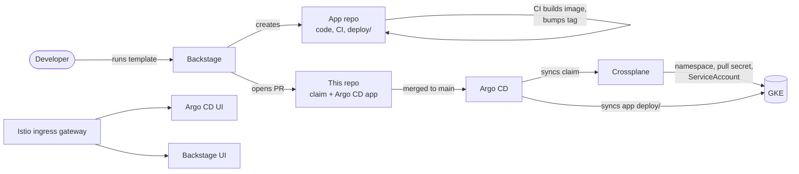

# platform-repository

A GitOps repo for a small internal developer platform on GKE:

- **Backstage** for self-service: a template creates a new app.
- **Argo CD** for delivery: it syncs everything in this repo from `main`.
- **Crossplane** for provisioning: it gives each app a namespace and a registry pull secret.
- **Istio** for ingress: its ingress gateway exposes the Argo CD and Backstage UIs.

The repo contains only Kubernetes, Argo CD and Backstage manifests. Nothing in it needs building. A change reaches the cluster once it's merged to `main` and Argo CD syncs it.

## How it fits together

Onboarding an app (`appname`, `env`) through the Backstage template **Local Cluster + App + CI** does three things:

1. It creates the GitHub repo `ehalilovic700/<appname>` from `local-k8s-cluster/skeleton/app-repo`. The repo contains a Flask app, a CI workflow that pushes the image to GHCR and updates the image tag in `deploy/`, and the Kubernetes manifests.
2. It opens a PR against this repo that adds two files:
   - `infrastructure/crossplane/claims/<appname>-<env>.yaml`: a `LocalCluster` claim. Crossplane turns it into the namespace `<appname>-<env>`, the `ghcr-secret` pull secret, and a patch to the namespace's default ServiceAccount so it uses that secret.
   - `infrastructure/argocd/backend/applications/<appname>-<env>.yaml`: an Argo CD Application that deploys the app repo's `deploy/` folder into that namespace.
3. It registers the app in the Backstage catalog.

## Layout

| Path | Contents |
|---|---|
| `infrastructure/argocd/applications/` | The two root Argo CD apps, applied once with `kubectl`: the Crossplane layer and the app-of-apps for per-app Applications |
| `infrastructure/argocd/backend/applications/` | Per-app Argo CD Applications, added by the template's PRs |
| `infrastructure/argocd/platform/` | Platform services: Istio (`base`, `istiod`, ingress gateway), Backstage, and the ingress routes |
| `infrastructure/crossplane/` | Provider, function, XRD (`XLocalCluster` / `LocalCluster`), Composition and claims |
| `infrastructure/istio/` | The Istio `Gateway` and the `VirtualService`s for Argo CD and Backstage |
| `local-k8s-cluster/` | The Backstage template and the skeletons it renders |

## Getting started

[`GKE-SETUP.md`](GKE-SETUP.md) is the step-by-step runbook. In short:

1. Create a GKE cluster, then install Argo CD and Crossplane (steps 1–4).
2. Apply the root Argo CD app and grant provider-kubernetes cluster access (steps 6–7).
3. Apply the app-of-apps for per-app Applications (step 8).
4. Reserve a static IP and install Istio and the ingress gateway, then restrict access to your own IP (step 10).
5. Install Backstage and the routes that expose both UIs (step 11).

## Accessing the UIs

Hostnames use [nip.io](https://nip.io), so they resolve to the ingress IP without any DNS setup:

| UI | URL |
|---|---|
| Argo CD | `https://argocd.<INGRESS_IP>.nip.io` (TLS passed through to Argo CD's self-signed certificate) |
| Backstage | `http://backstage.<INGRESS_IP>.nip.io` (sign in as Guest) |

To find the ingress IP: `kubectl -n istio-ingress get svc istio-ingressgateway`.

## Security notes

- **No credentials in git.**
  - The GHCR pull secret in the composition is an empty placeholder, so it only works for public images.
  - Backstage's GitHub token comes from a Secret (`backstage/backstage-github`) that you create by hand.
- **The ingress only accepts your own IP.** The `loadBalancerSourceRanges` setting on the gateway Service is applied with `kubectl patch` rather than committed, so your home IP stays out of this public repo. Re-run step 10c in the runbook whenever your IP changes.
- **Backstage is the chart's demo image.** It uses an in-memory database and guest sign-in, so it's suitable only for a sandbox.
- **Change the Argo CD `admin` password** after your first login, then delete `argocd-initial-admin-secret`.

## Known limitations

- Per-app Argo CD Applications have no retry. If one syncs before Crossplane has created its namespace, sync it again manually.
- The template's output text names `infrastructure/argocd/applications`, but per-app files are actually written to `infrastructure/argocd/backend/applications`.
- The static ingress IP is hardcoded in `infrastructure/istio/` and `infrastructure/argocd/platform/`. A new sandbox means a new IP: replace it in those files and push.
